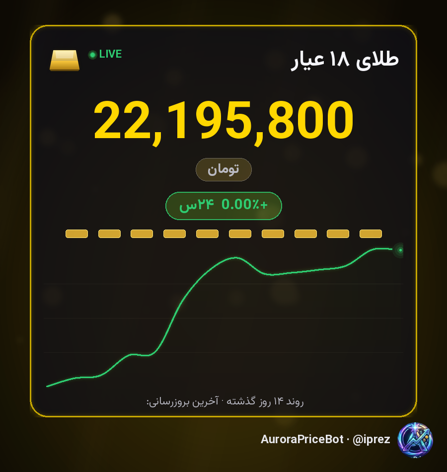
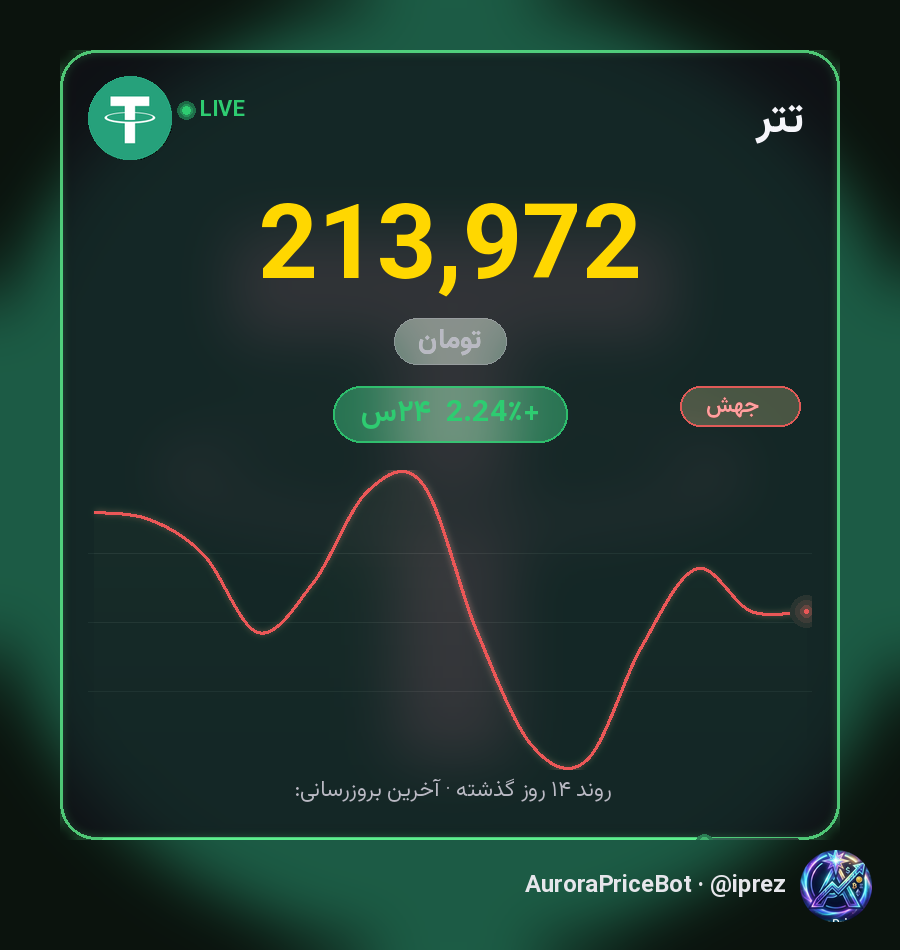

<div align="center">


# 🔥 AuroraPriceBot

**ربات تلگرام قیمت لحظه‌ای ارز، طلا، سکه و رمزارز**
بنرهای ویدیویی زنده با تم **Ember** — قیمت خیابانی واقعی، بدون حتی یک کلید API

[](https://www.python.org)
[](https://python-telegram-bot.org)
[](#-لایسنس)
[](https://t.me/iprez)

</div>

---

## 📋 فهرست مطالب

- [✨ نمای کلی](#-نمای-کلی)
- [🎯 پوشش بازار](#-پوشش-بازار)
- [🔥 بنر Ember](#-بنر-ember)
- [🧮 ماشین‌حساب ارز](#-ماشینحساب-ارز)
- [💬 دستورات و Ghost Mode](#-دستورات-و-ghost-mode)
- [💲 قوانین قیمت‌گذاری](#-قوانین-قیمتگذاری)
- [📊 منابع داده](#-منابع-داده)
- [🛠 پنل ادمین](#-پنل-ادمین)
- [🏗 معماری](#-معماری)
- [🚀 نصب و اجرا](#-نصب-و-اجرا)
- [⚙️ متغیرهای محیطی](#-متغیرهای-محیطی)
- [🔒 امنیت و حریم خصوصی](#-امنیت-و-حریم-خصوصی)
- [❓ سوالات متداول](#-سوالات-متداول)
- [📜 لایسنس](#-لایسنس)

---

## ✨ نمای کلی

**AuroraPriceBot** یک ربات تلگرام فارسی‌زبان است که قیمت‌های لحظه‌ای را از چند منبع معتبر جمع می‌کند و در قالب **بنر تصویری و ویدیویی متحرک** تحویل می‌دهد — فقط کافی است اسم دارایی را بنویسی: `دلار`، `طلا`، `بیت‌کوین`…

> 🇮🇷 **ساخته‌شده برای بازار ایران:** دلار و تتر با **قیمت خرید واقعی والکس + حاشیه‌ی بازار** نمایش داده می‌شوند — یعنی همان عددی که در خیابان معامله می‌شود، نه شاخص خام.

- ⚡ **بدون کلید API** — همه‌ی منابع عمومی‌اند؛ نه ثبتنامی می‌خواهد، نه بن‌شدن دارد
- 🎬 **بنر ویدیویی MP4** با شمارش قیمت از صفر، نمودار هم‌زمان و بج LIVE چشمک‌زن واقعی
- 🖼 **بنر تصویری PNG** با همان طراحی، برای پاسخ فوری
- 👻 **Ghost Mode** — در گروه‌ها فقط به پیام‌های کوتاه و مستقیم جواب می‌دهد و مزاحم گپ نمی‌شود
- 🧮 **ماشین‌حساب داخلی** — «۱۲۵ دلار»، «۲ گرم طلا»، «۰٫۵ بیت‌کوین» را مستقیم به تومان حساب می‌کند

---

## 🎯 پوشش بازار

| دسته | تعداد | نمونه‌ها |
|------|:-----:|----------|
| 💵 **ارزهای فیات** | **۶۵ ارز** | دلار، یورو، پوند، درهم، لیر، فرانک سوئیس، ین، روبل، دینار کویت، ریال عربستان، روپیه، کرون و… |
| 🥇 **طلا و سکه** | **۸ مورد** | طلای ۱۸ عیار، طلای ۲۴ عیار، سکه امامی، بهار آزادی، نیم‌سکه، ربع‌سکه، سکه گرمی، طلای آب‌شده |
| 💲 **تتر (USDT)** | بازار داخلی | قیمت خرید لحظه‌ای والکس + سقف/کف واقعی ۲۴ ساعته |
| 🪙 **رمزارزها** | **۲۹ کریپتو** | بیت‌کوین، اتریوم، سولانا، تون‌کوین (GRAM)، ریپل، دوج‌کوین، شیبا، پپه و… |

قیمت رمزارزها **دلاری (USD)** و بقیه‌ی دارایی‌ها **تومانی** نمایش داده می‌شوند.

---

## 🔥 بنر Ember

همه‌ی بنرها — برای تک‌تک دارایی‌ها — با یک طراحی واحد و زنده تولید می‌شوند؛ هیچ تصویر دستی‌ای در کار نیست:

- 🌇 **تم Ember Sunset** — گرادیان گرم آلویی تا نارنجی، کارت شیشه‌ای تیره و تایپوگرافی کهربایی
- 🔢 **شمارش از صفر** — قیمت از `0` تا عدد نهایی می‌شمارد؛ نمودار و نشانگر بازه **دقیقاً با همان حرکت** جلو می‌روند
- 📈 **نمودار نرم (Catmull-Rom)** با نقطه‌ی پایانی پالس‌دار
- 🎚 **نوار موقعیت ۲۴ ساعته** — جای قیمت بین کف و سقف روز، با LOW/HIGH واقعی
- 🔴 **بج LIVE چشمک‌زن** — نقطه‌ی لایو واقعاً روشن و خاموش می‌شود، با حلقه‌ی موجی دور لوگو
- ✨ **ذرات جرقه‌ی شناور** و هاله‌ی خورشیدیِ نفس‌کشنده
- 🏳 **آیکون اختصاصی هر دارایی** — پرچم ارزها، لوگوی رمزارزها و شمش طلا برای خانواده‌ی طلا/سکه

| دلار آمریکا | طلای ۱۸ عیار | بیت‌کوین | تتر (USDT) | یورو |
|:---:|:---:|:---:|:---:|:---:|
|  |  |  |  |  |

> 💡 اسکرین‌شات‌ها ثابت‌اند؛ نسخه‌ی اصلی **ویدیویی** است و لحظه‌ای توسط خود کد رندر می‌شود.

---

## 🧮 ماشین‌حساب ارز

فقط **عدد + اسم دارایی** را بنویس؛ ربات معادل تومانی/دلاری را حساب می‌کند:

```
۱۲۵ دلار        →  معادل تومانی ۱۲۵ دلار
۲ گرم طلا       →  قیمت ۲ گرم طلای ۱۸ عیار
۰.۵ بیت‌کوین    →  ارزش دلاری + تومانی
1,000,000 یورو  →  با جداکننده‌ی هزارگان هم کار می‌کند
```

از اعداد فارسی و انگلیسی، اعشار و جداکننده‌ی هزارگان پشتیبانی می‌شود و چهار عمل اصلی (`+ − × ÷`) هم در دسترس است.

---

## 💬 دستورات و Ghost Mode

| دستور | توضیح |
|-------|-------|
| `/start` | خوش‌آمدگویی + منوی سریع (دکمه‌های Inline) |
| `/ping` | تست پینگ (TCP + هندشیک TLS تلگرام) |
| `/admin` | 🛠 پنل ادمین — فقط مالک |
| `/cancel_bc` | لغو فوری ارسال همگانی در حال انجام |

### 👻 استفاده‌ی بدون دستور

کافی است اسم دارایی را بفرستی:

```
دلار        →  بنر دلار          طلا      →  بنر طلای ۱۸ عیار
بیت‌کوین    →  بنر BTC           بازار    →  کارت «بازار امروز»
تون         →  بنر تون‌کوین      یورو     →  بنر یورو
```

با دکمه‌های ◀️ ▶️ زیر بنر (**Carousel**) می‌توانی بین دارایی‌های محبوب بچرخی، بدون این که دوباره تایپ کنی.

---

## 💲 قوانین قیمت‌گذاری

| دارایی | فرمول |
|--------|-------|
| **دلار** | قیمت «خرید ارز» والکس × **۱٫۰۰۳** (حاشیه‌ی بازار ۰٫۳٪) |
| **تتر** | دقیقاً مثل دلار — برای همین دلار و تتر همیشه یک عدد چاپ می‌کنند |
| **بقیه‌ی فیات‌ها** | قیمت خرید والکس × نرخ جهانی (Binance FX) + **۰٫۵٪** حاشیه‌ی بازار |
| **طلا و سکه** | نرخ لحظه‌ای TGJU |
| **رمزارزها** | آخرین قیمت Binance (جفت USDT) — تون‌کوین روی جفت `GRAMUSDT` سوار است |

حاشیه‌ی دلار/تتر با ثابت `MARKET_MARGIN_PCT` در `datafeeds.py` تعریف شده و از یک نقطه کنترل می‌شود.

---

## 📊 منابع داده

| منبع | نقش |
|------|-----|
| **Wallex** | قیمت خرید لحظه‌ای دلار/تتر (مرجع اصلی بازار داخلی) + سقف/کف ۲۴ساعته‌ی تتر |
| **Binance** | نرخ جهانی فیات‌ها، قیمت و تغییرات ۲۴ساعته‌ی رمزارزها، کندل‌های نمودار |
| **TGJU** | طلا و سکه + فالبک نهایی فیات‌ها و تاریخچه‌ی نمودار |
| **er-api** | فالبک نرخ فیات‌هایی که جفت Binance ندارند |

زنجیره‌ی فالبک طوری چیده شده که اگر یک منبع خوابید، بنر باز هم با عدد درست برسد — و اگر هیچ‌کدام نشد، ربات به‌جای عدد اشتباه، هیچ بنری نمی‌سازد.

---

## 🛠 پنل ادمین

با `/admin` (فقط `OWNER_ID`):

- 📊 **آمار کلی** — کاربران، گروه‌ها، پیام‌ها و نمودار فعالیت ۷ روزه
- 👥 **لیست کاربران** — صفحه‌بندی‌شده با آخرین فعالیت
- 👨‍👩‍👧‍👦 **مدیریت گروه‌ها** — لیست صفحه‌بندی‌شده با چراغ فعالیت (🟢/🟡/⚪)، تعداد پیام و آخرین حضور
  - 👁 **بازرسی زنده** — عنوان، یوزرنیم و تعداد اعضای فعلی گروه، همان لحظه از تلگرام
  - 🔗 **لینک دعوت** — ساخت و ذخیره‌ی لینک تازه برای هر گروه
  - 📣 **ارسال هدفمند** — پیام همگانی فقط به یک گروه مشخص
  - 🚪 **خروج از گروه** — با تأیید دو مرحله‌ای
- 📢 **ارسال همگانی** به همه‌ی کاربران/گروه‌ها — قابل لغو با `/cancel_bc`

---

## 🏗 معماری

```
Aurora-price-vip/
├── bot.py        # نقطه‌ی ورود — هندلرها، Ghost Mode، ماشین‌حساب، Carousel
├── catalog.py    # کاتالوگ دارایی‌ها (فیات/طلا/تتر/کریپتو) + نام‌های نمایشی EN
├── datafeeds.py  # منابع داده، زنجیره‌ی فالبک و قوانین قیمت‌گذاری
├── banner.py     # موتور رندر Ember — بنر PNG و ویدیوی MP4
├── render.py     # کارت «بازار امروز»
├── admin.py      # آمار، کاربران و مدیریت گروه‌ها (ذخیره‌ی اتمیک)
├── assets/       # پرچم‌ها، آیکون رمزارزها و لوگوی ربات
├── fonts/        # فونت‌های Vazir
├── hist/         # تاریخچه‌ی دقیقه‌ای قیمت‌ها (ثبت خودکار هنگام رندر)
└── tests/        # تست‌ها:  python -m tests.test_bot
```

- **Long-polling** — بدون webhook، بدون پورت و دامنه
- **کش چندلایه** — بنر تصویری ۵ ثانیه، ویدیو ۲۵ ثانیه، پس‌زمینه‌ی هر دارایی به‌صورت جدا؛ رندر تکراری تقریباً صفر است
- **رندر سبک** — فریم‌ها مستقیم با Pillow به ffmpeg داده می‌شوند (بدون numpy) تا روی سرورهای کوچک هم روان اجرا شود

---

## 🚀 نصب و اجرا

پیش‌نیاز: **Python 3.11+** (ffmpeg لازم نیست — `imageio-ffmpeg` باینری خودش را همراه دارد).

```bash
# ۱. کلون
git clone https://github.com/abapqlcm/Aurora-price-vip.git
cd Aurora-price-vip

# ۲. وابستگی‌ها (ترجیحاً داخل venv)
python -m venv .venv
source .venv/bin/activate        # ویندوز: .venv\Scripts\activate
pip install -r requirements.txt

# ۳. توکن ربات (از BotFather) — OWNER_ID اختیاری است
export BOT_TOKEN=123456:ABC-DEF...

# ۴. اجرا
python bot.py
```

در تلگرام `/start` را بزن و بنویس `دلار` 🎉

**تست‌ها:**

```bash
python -m tests.test_bot
```

> ⚠️ بدون `BOT_TOKEN` ربات بالا نمی‌آید — توکن فقط از متغیر محیطی خوانده می‌شود و در نبودش برنامه با خطا خارج می‌شود.

---

## ⚙️ متغیرهای محیطی

| متغیر | اجباری | توضیح |
|-------|:------:|-------|
| `BOT_TOKEN` | ✅ | توکن ربات از BotFather |
| `OWNER_ID` | ❌ | آیدی عددی مالک — برای فعال‌شدن پنل `/admin` |

---

## 🔒 امنیت و حریم خصوصی

- توکن و آیدی مالک **فقط** از متغیرهای محیطی خوانده می‌شوند؛ هیچ رازی در کد نیست
- پنل ادمین فقط برای `OWNER_ID` باز می‌شود و بقیه‌ی کاربران به آن دسترسی ندارند
- آمار (کاربر/گروه/تعداد پیام) به‌صورت **اتمیک** ذخیره می‌شود تا با قطع برق یا ری‌استارت خراب نشود
- ربات هیچ پیام شخصی‌ای را ذخیره نمی‌کند — فقط شمارنده‌های آماری نگه داشته می‌شوند

---

## ❓ سوالات متداول

**چرا دلار و تتر دقیقاً یک عددند؟**
چون هر دو از قیمت خرید والکس با حاشیه‌ی یکسان (۰٫۳٪) ساخته می‌شوند — عمداً، تا «قیمت خیابانی» یکی باشد.

**چرا قیمت ربات با سایت والکس کمی فرق دارد؟**
عدد سایت، شاخص خام است؛ ربات قیمت **خرید واقعی + حاشیه‌ی بازار** را نشان می‌دهد — همان عددی که معامله باهاش انجام می‌شود.

**ویدیو برای یک ارز ساخته نشد، چرا؟**
اگر همه‌ی منابع داده هم‌زمان در دسترس نباشند، ربات بنر اشتباه نمی‌سازد؛ چند ثانیه بعد دوباره تلاش کن.

**می‌توانم ارز جدید اضافه کنم؟**
بله — فقط یک ردیف در `catalog.py` (نام، آیکون، منبع)؛ بنر، ماشین‌حساب و Carousel خودکار پوششش می‌دهند.

---

## 📜 لایسنس

منتشرشده تحت لایسنس **MIT** — استفاده، کپی و تغییر آزاد است.

<div align="center">

ساخته‌شده با ❤️ توسط [@iprez](https://t.me/iprez) — **AuroraPriceBot**

</div>
