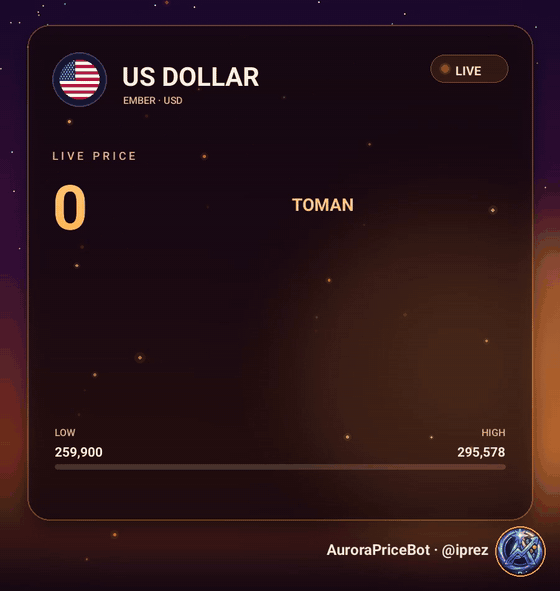
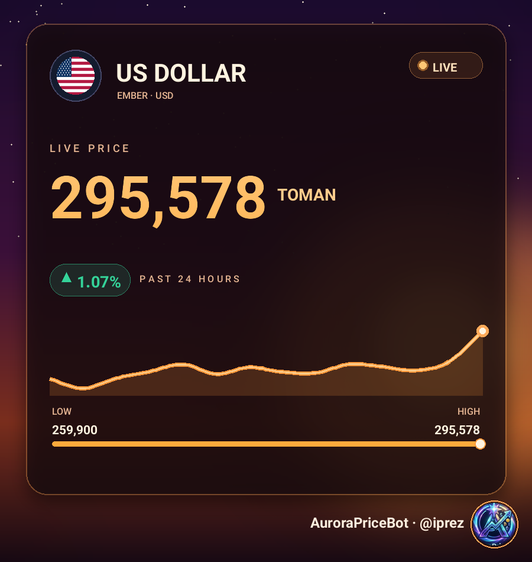
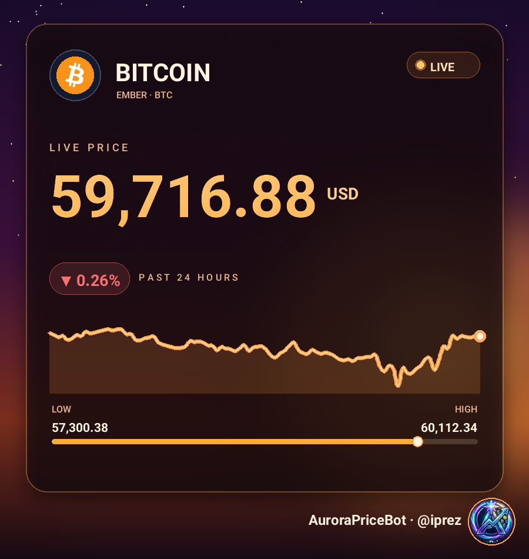
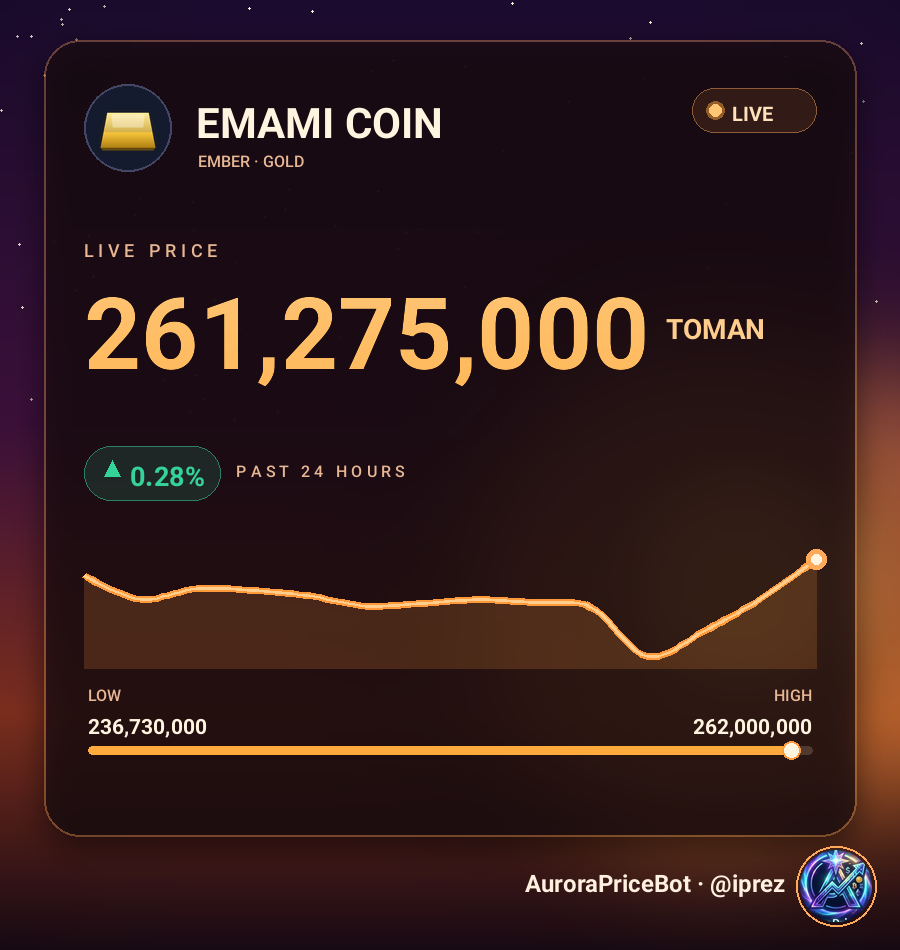
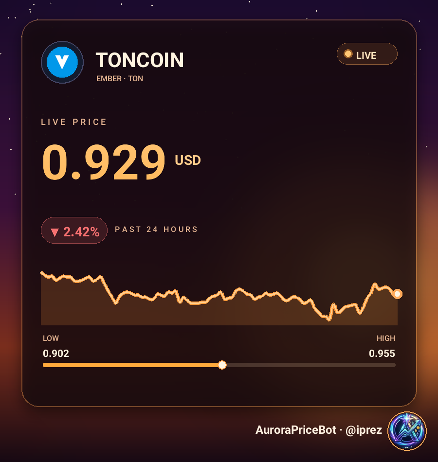

<div align="center">


# 🔥 AuroraPriceBot

### ربات قیمت زنده‌ی ارز، طلا، سکه و کریپتو — با بنر ویدیویی **Ember**

قیمت لحظه‌ای **۶۵ ارز فیات**، **طلا و سکه**، **تتر** و **۲۹ رمزارز** را با یک پیام بگیرید:
بنر تصویری و ویدیویی زنده، نمودار ۲۴ ساعته، ماشین‌حساب تبدیل و پنل مدیریت کامل.

[](https://www.python.org/)
[](https://python-telegram-bot.org/)
[](https://python-pillow.org/)
[](LICENSE)



*بنر ویدیویی Ember — شمارش قیمت از صفر، رسم هم‌زمان نمودار و نوار بازه، بج LIVE چشمک‌زن واقعی*

</div>

---

## 📑 فهرست

- [🎨 گالری بنر Ember](#-گالری-بنر-ember)
- [✨ قابلیت‌ها](#-قابلیتها)
- [🔥 بنر Ember](#-بنر-ember)
- [💱 پوشش بازار](#-پوشش-بازار)
- [🧮 قوانین قیمت‌گذاری](#-قوانین-قیمتگذاری)
- [⌨️ دستورها و نحوه‌ی استفاده](#️-دستورها-و-نحوهی-استفاده)
- [🛠 پنل ادمین](#-پنل-ادمین)
- [⚡ سرعت و عملکرد](#-سرعت-و-عملکرد)
- [🏗 معماری پروژه](#-معماری-پروژه)
- [🚀 نصب و اجرا](#-نصب-و-اجرا)
- [🔐 امنیت و حریم خصوصی](#-امنیت-و-حریم-خصوصی)
- [❓ پرسش‌های پرتکرار](#-پرسشهای-پرتکرار)
- [📄 لایسنس](#-لایسنس)

---

## 🎨 گالری بنر Ember

<div align="center">
<table>
<tr>
<td align="center"><br><b>دلار آمریکا</b> — تومان</td>
<td align="center"><br><b>بیت‌کوین</b> — USD</td>
</tr>
<tr>
<td align="center"><br><b>سکه امامی</b> — تومان</td>
<td align="center"><br><b>تون‌کوین</b> — USD</td>
</tr>
</table>
</div>

> همه‌ی بنرهای بالا **زنده و واقعی** از خود ربات گرفته شده‌اند — برای هر دارایی، آیکون (پرچم/سکه/لوگوی کوین)،
> واحد (تومان یا USD)، قالب قیمت و نمودار به‌صورت خودکار با همان دارایی تنظیم می‌شود.

---

## ✨ قابلیت‌ها

| قابلیت | توضیح |
|---|---|
| 🎬 **بنر ویدیویی Ember** | انیمیشن ۳ ثانیه‌ای ۲۴ فریم: شمارش قیمت از صفر + نمودار و نوار بازه‌ی هم‌زمان + LIVE چشمک‌زن |
| 🖼 **بنر تصویری** | نسخه‌ی ثابت همان طراحی، برای پاسخ سریع و فالبک |
| 📈 **نمودار ۲۴ ساعته** | منحنی هموار (Catmull-Rom) + کمینه/بیشینه‌ی واقعی و نشانگر جایگاه قیمت |
| 🧮 **ماشین‌حساب** | «عدد + اسم دارایی» با عملگرهای `+ − × ÷`، ارقام فارسی/انگلیسی و جداکننده‌ی هزارگان |
| 🎠 **Carousel** | دکمه‌های جابه‌جایی بین دارایی‌ها زیر هر بنر |
| 👻 **Ghost Mode** | پاسخ در گروه‌ها بدون شلوغی — بنر تمیز با کپشن کامل |
| 📊 **کارت بازار امروز** | گرید چنددارایی: برنده‌های روز، طلا و کریپتو در یک تصویر |
| 🛠 **پنل ادمین کامل** | کاربران، گروه‌ها با بازرسی زنده، ارسال همگانی و تک‌گروهی، سلامت سیستم |
| ⚡ **رندر موازی دوهسته‌ای** | رندر ویدیو روی هر دو هسته + کش گرم دائمی برای ۲۰ دارایی پرتکرار |
| 🔁 **فالبک چندلایه‌ی دیتا** | والکس ← بایننس ← TGJU ← er-api؛ قطع یک منبع یعنی ادامه‌ی کار با منبع بعدی |

---

## 🔥 بنر Ember

تم رسمی بنر ربات — غروبِ گدازه‌ای (Ember Sunset):

- **پس‌زمینه:** گرادیان آلویی تیره به کهربایی سوخته، هاله‌ی خورشیدِ «نفس‌کشنده»، ستاره‌های ثابت و ذرات جرقه‌ی شناور
- **کارت شیشه‌ای** با سایه‌ی نرم و وینیت سینمایی؛ قیمت با **گرادیان کهربایی** و فونت تطبیقی (از قیمت‌های چندمیلیونی سکه تا اعشار ریز شیبا)
- **آیکون هر دارایی:** پرچم کشور برای فیات، شمش طلا برای خانواده‌ی طلا/سکه، لوگوی رسمی برای کریپتو
- **بج LIVE** با چشمک واقعی روشن/خاموش (چرخه‌ی ۱٫۲ ثانیه) + حلقه‌ی سونار ملایم دور لوگوی ربات
- **انیمیشن ویدیو — یک محرک واحد:** شمارش قیمت **از صفر**، رسم نمودار و لغزش نشانگر بازه هر سه با یک پیشرفت اصلی حرکت می‌کنند؛ شروع و پایان‌شان دقیقاً با هم است و نشانگر هرگز عقب‌جلو نمی‌شود
- چیپ درصد تغییر ۲۴ ساعته (▲ سبز / ▼ قرمز) با ورود نرم در پایان انیمیشن
- خروجی ویدیو: MP4 ‏(H.264، ‏۹۰۰×۹۵۰، ‏۲۴fps، سه ثانیه) — به‌صورت Animation تلگرام پخش و لوپ می‌شود

---

## 💱 پوشش بازار

| دسته | تعداد | نمونه‌ها |
|---|---|---|
| 💵 ارز فیات | **۶۵** | دلار، یورو، پوند، درهم، لیر، فرانک، دلار کانادا/استرالیا، یوان، ین، دینار کویت، ریال عمان/قطر/عربستان، روبل و… |
| 🥇 طلا و سکه | **۸** | طلای ۱۸ و ۲۴ عیار، آب‌شده، سکه‌ی امامی، بهار آزادی، نیم، ربع و گرمی |
| 💲 استیبل | **۱** | تتر (USDT) به تومان |
| 🪙 کریپتو | **۲۹** | BTC ،ETH ،BNB ،SOL ،XRP ،DOGE ،SHIB ،TON ،ADA ،LTC ،AVAX ،LINK ،DOT ،TRX و… |

نام دارایی را به **فارسی یا انگلیسی** بفرستید («دلار»، «سکه امامی»، `BTC`، `gold`) — ربات خودش تشخیص می‌دهد.

---

## 🧮 قوانین قیمت‌گذاری

شفاف و ثابت — دقیقاً همان چیزی که بنر چاپ می‌کند:

| دارایی | قانون |
|---|---|
| **دلار** | نرخ **خرید والکس** × ‏۱٫۰۰۳ (حاشیه‌ی بازار `MARKET_MARGIN_PCT = 0.3`) |
| **تتر** | دقیقاً برابر دلار — با همان فرمول ساخته می‌شود تا این دو عدد هرگز از هم جدا نشوند |
| **بقیه‌ی فیات‌ها** | نرخ والکس × نرخ تبدیل بایننس، با حاشیه‌ی داخلی ۰٫۵٪ |
| **طلا و سکه** | نرخ زنده‌ی TGJU |
| **کریپتو** | آخرین قیمت بایننس (`lastPrice`) — **TON روی جفت GRAMUSDT** سوار است (جفت TONUSDT چاپ یخ‌زده دارد) |

**منابع دیتا و زنجیره‌ی فالبک:** والکس (نرخ تومانی و تاریخچه) · بایننس (کریپتو و FX) · TGJU (طلا/سکه و فالبک نهایی) · er-api (فالبک ISO فیات‌ها).

---

## ⌨️ دستورها و نحوه‌ی استفاده

| دستور | کار |
|---|---|
| `/start` | شروع و راهنمای سریع |
| `/ping` | بررسی زنده‌بودن ربات |
| `/admin` | پنل مدیریت (فقط مالک) |
| `/cancel_bc` | لغو ارسال همگانی در حال انجام |

**استفاده‌ی روزمره:** فقط اسم دارایی را بفرستید — `دلار`، `یورو`، `سکه`، `بیت‌کوین`، `TON`…
برای محاسبه: `100 دلار`، `2.5 BTC`، یا عبارت کامل مثل `100 × دلار + 50 یورو` (ارقام فارسی و انگلیسی، با و بدون جداکننده‌ی هزارگان).

---

## 🛠 پنل ادمین

با `/admin` (فقط مالک ربات):

- **داشبورد:** کاربران، فعال‌های ۲۴ ساعت/۷ روز، تعداد گروه‌ها، پیام‌های امروز و مجموع
- **👥 کاربران:** ۱۰ کاربر آخر با تعداد پیام
- **👨‍👩‍👧‍👦 گروه‌ها:** فهرست صفحه‌بندی (۵ گروه در هر صفحه) با **چراغ فعالیت** (🟢 زیر ۱ ساعت · 🟡 زیر ۲۴ ساعت · ⚪ قدیمی‌تر)، تعداد پیام و آخرین حضور نسبی؛ دکمه‌ی هر گروه **با اسم خود گروه**:
  - 👁 **جزئیات زنده:** تعداد اعضای واقعی، عنوان و یوزرنیم به‌روز (از خود تلگرام خوانده می‌شود)
  - 🔗 **لینک جدید:** ساخت و ذخیره‌ی لینک دعوت تازه
  - 📢 **پیام به همین گروه:** ارسال هدفمند فقط به همان یک گروه
  - 🚪 **خروج از گروه:** با تأیید دو مرحله‌ای
- **📢 ارسال همگانی:** یک پیام به همه‌ی کاربران، با گزارش نهایی موفق/ناموفق و امکان لغو وسط کار
- **📈 نمودار ۷ روز** فعالیت و **🏥 سلامت** سیستم

---

## ⚡ سرعت و عملکرد

بنر ویدیویی محصول اصلی ربات است؛ برای همین موتور رندر چند بار بهینه شده:

- **رندر موازی روی ۲ هسته:** فریم‌های ویدیو بین دو پردازش تقسیم و بدون بازکدگذاری به هم چسبانده می‌شوند؛ رندر سرد از **۴٫۵۵ ثانیه به حدود ۲٫۲ ثانیه** رسیده — با فالبک خودکار به مسیر سریال
- **بهینه‌سازی فریم:** هاله‌ی خورشید از پیش در پایه پخته می‌شود و گرادیان قیمت فقط روی نوار قیمت کامپوزیت می‌شود (ظاهر دقیقاً همان است، هزینه کمتر)
- **کش‌ها:** ویدیو ۶۰ ثانیه · تصویر ۲۰ ثانیه · پایه‌ی بنر و آیکون‌ها کش دائمی — قیمت داخل بنر کش‌شده با کپشنش همیشه سازگار است
- **حلقه‌ی گرم‌کن (Warm Loop):** ۲۰ دارایی پرتکرار (دلار، تتر، یورو، بیت‌کوین، طلای ۱۸، سکه امامی و گرمی، دینار کویت، تون و…) در پس‌زمینه مداوم تازه نگه داشته می‌شوند تا بیشتر درخواست‌ها **فوری از کش** پاسخ بگیرند
- انکودر: ffmpeg همراه پکیج `imageio-ffmpeg` — **بدون نیاز به نصب ffmpeg روی سیستم**

---

## 🏗 معماری پروژه

```
Aurora-price-vip/
├── bot.py         # نقطه‌ی ورود — هندلرها، پنل ادمین، حلقه‌ی گرم‌کن
├── banner.py      # موتور بنر Ember (تصویر + ویدیوی موازی) و کارت بازار
├── datafeeds.py   # دریافت دیتا: والکس، بایننس، TGJU، er-api + کش و فالبک
├── catalog.py     # کاتالوگ دارایی‌ها: فیات، طلا، استیبل، کریپتو + نام نمایشی انگلیسی
├── admin.py       # آمار کاربران/گروه‌ها و ابزارهای پنل
├── render.py      # قالب‌بندی متن، اعداد و کپشن‌ها
├── assets/        # لوگو، پرچم‌ها و آیکون‌ها (+ تصاویر این README)
├── hist/          # تاریخچه‌ی محلی قیمت‌ها (فالبک آفلاین)
└── tests/         # تست‌های واحد
```

---

## 🚀 نصب و اجرا

```bash
git clone https://github.com/abapqlcm/Aurora-price-vip.git
cd Aurora-price-vip
python3 -m venv .venv
.venv/bin/pip install -r requirements.txt
```

| متغیر محیطی | لازم؟ | توضیح |
|---|---|---|
| `BOT_TOKEN` | ✅ | توکن ربات از BotFather |
| `OWNER_ID` | اختیاری | آیدی عددی مالک برای پنل ادمین |

```bash
BOT_TOKEN=... .venv/bin/python bot.py
```

نیازمندی‌ها: Python 3.11+ · `python-telegram-bot 21.4` · `requests` · `pillow` · `arabic-reshaper` · `python-bidi` · `imageio-ffmpeg` (ffmpeg آماده داخل خودش دارد).

---

## 🔐 امنیت و حریم خصوصی

- پنل ادمین و ارسال همگانی **فقط برای مالک** (`OWNER_ID`) باز است؛ بقیه پاسخ «فقط مالک» می‌گیرند.
- توکن ربات فقط از متغیر محیطی خوانده می‌شود و در هیچ فایلی از ریپو نیست.
- ربات فقط شمارنده‌های آماری (تعداد پیام و آخرین فعالیت) نگه می‌دارد — **متن پیام‌های کاربران ذخیره نمی‌شود**.

---

## ❓ پرسش‌های پرتکرار

**چرا قیمت دلار و تتر همیشه یکی است؟**
چون هر دو از یک فرمول ساخته می‌شوند (خرید والکس × ۱٫۰۰۳) — عمدی است تا عدد «دلار بازار» و «تتر» هرگز دو روایت جدا نشوند.

**بنر ویدیویی چقدر طول می‌کشد؟**
برای ۲۰ دارایی پرتکرار تقریباً فوری (کش گرم)؛ برای بقیه حدود ۲ ثانیه رندر موازی. اگر ویدیو به هر دلیل آماده نشود، بنر تصویری همان لحظه ارسال می‌شود.

**چطور دارایی جدید اضافه کنم؟**
یک ردیف در `catalog.py` (نام فارسی، منبع قیمت و آیکون) کافی است — بنر، ماشین‌حساب و Carousel خودکار پوششش می‌دهند.

**ربات در گروه هم کار می‌کند؟**
بله — کافی است عضو گروه باشد؛ اسم دارایی را بفرستید و بنر را بگیرید. مدیریت همان گروه‌ها از پنل ادمین انجام می‌شود.

---

## 📄 لایسنس

منتشرشده تحت **MIT License** — استفاده، تغییر و انتشار با ذکر منبع آزاد است.

<div align="center">

ساخته‌شده با 🔥 برای بازار ایران — **AuroraPriceBot**

</div>
