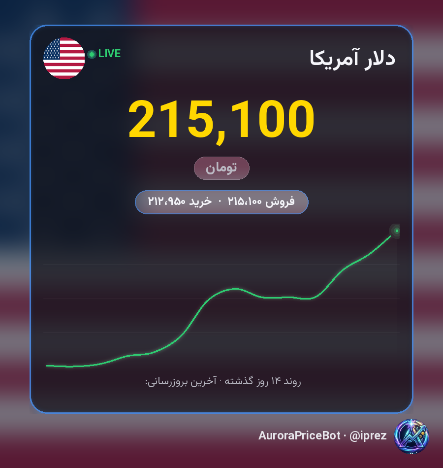
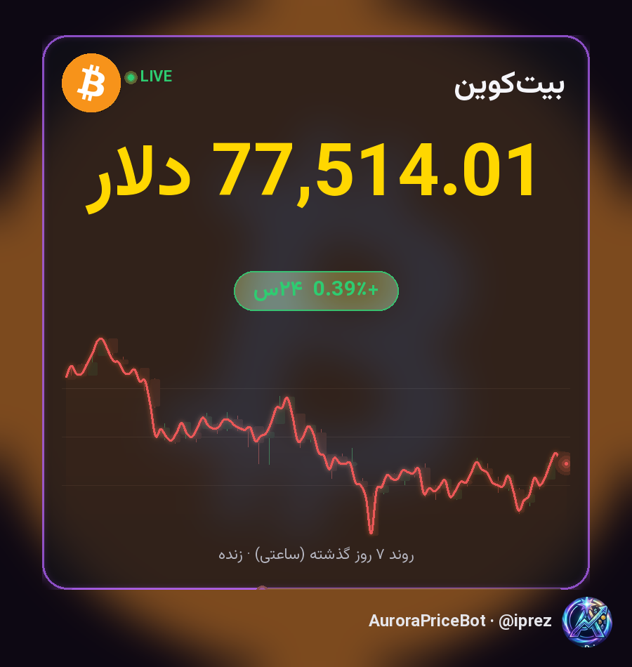
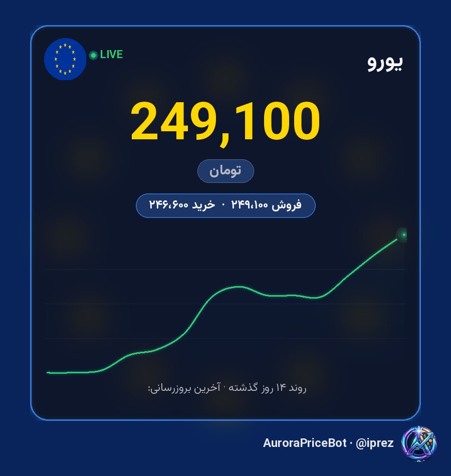

# 💱 AuroraPriceBot

> **ربات تلگرام قیمت لحظه‌ای ارز، طلا، سکه و رمزارز** — با بنرهای تصویری متحرک، طراحی لوکس و صفر وابستگی به کلید API.

[](https://www.python.org)
[](#-لایسنس)
[](https://railway.app)
[](https://t.me/iprez)

<p align="center">
  
</p>

---

## 📋 فهرست مطالب

- [✨ نمای کلی](#-نمای-کلی)
- [🎯 ویژگی‌ها](#-ویژگیها)
- [🖼 گالری بنرها](#-گالری-بنرها)
- [🚀 نصب و اجرای محلی](#-نصب-و-اجرای-محلی)
- [🚂 دیپلوی روی Railway](#-دیپلوی-روی-railway)
- [📖 راهنمای دستورات](#-راهنمای-دستورات)
- [🧮 ماشین‌حساب ارز](#-ماشینحساب-ارز)
- [🛠 پنل ادمین](#-پنل-ادمین)
- [🏗 معماری سیستم](#-معماری-سیستم)
- [📊 منابع داده](#-منابع-داده)
- [⚙️ متغیرهای محیطی](#-متغیرهای-محیطی)
- [🔒 حریم خصوصی و امنیت](#-حریم-خصوصی-و-امنیت)
- [📜 لایسنس](#-لایسنس)
- [❓ سوالات متداول (FAQ)](#-سوالات-متداول-faq)

---

## ✨ نمای کلی

AuroraPriceBot یک بات تلگرام فارسی‌زبانه که قیمت‌های لحظه‌ای رو از چندین منبع معتبر جمع‌آوری کرده و به‌صورت **بنرهای تصویری گرافیکی** (عکس + ویدیوی متحرک MP4) برمی‌گردونه. برخلاف ربات‌های متنی ساده، اینجا هر قیمت با:

- 📈 نمودار ناحیه‌ای (Area chart) یا کندل‌استیک (Candlestick)
- 🔴🟢 نشانگر LIVE با پالس سینوسی
- 💎 حاشیه‌ی نئونی با تغییر رنگ پیوسته (آبی → بنفش → طلایی → سبز)
- ✨ ذرات معلق متحرک (Particle effects)
- 🔢 انیمیشن شمارنده‌ی قیمت (Count-up)
- 🥇 لوگوی شمش طلای ۳D برای خانواده‌ی طلا/سکه

نمایش داده می‌شه.

> 🇮🇷 **مخصوص بازار ایران:** قیمت‌های ریالی (دلار، طلا، سکه، تتر) از منابع داخلی و قیمت‌های جهانی ارز/رمزارز از Binance محاسبه می‌شن.

---

## 🎯 ویژگی‌ها

| دسته | پوشش | جزئیات |
|------|------|--------|
| 💵 **ارزهای فیات** | **۶۵ ارز** | دلار، یورو، پوند، درهم، لیر، فرانک، ین، روبل، دینار کویت، ریال عربستان، روپیه، وون، کرون سوئد و… |
| 🥇 **طلا و سکه** | **۸ مورد** | طلای ۱۸ عیار، ۲۴ عیار، سکه امامی، بهار آزادی، نیم‌سکه، ربع‌سکه، گرمی، شمش |
| 💵 **تتر (USDT)** | بازار داخلی | قیمت ریالی لحظه‌ای + سقف/کف واقعی ۲۴ ساعت + معادل دلاری |
| 🪙 **رمزارزها** | **۲۹ کریپتو** | بیت‌کوین، اتریوم، سولانا، تون‌کوین، ریپل، دوج‌کوین، شیبا، پپه و… |
| 🧮 **ماشین‌حساب** | + − × ÷ | «۱۲۵ دلار»، «۲ گرم طلا»، «۰.۵ بیت‌کوین»، «۱,۰۰۰,۰۰۰ یورو» — با اعداد اعشاری و جداکننده هزارگان |
| 🎠 **کارت چرخشی** | Carousel | دکمه‌های ◀️ ▶️ برای جابجایی بین ارزهای محبوب |
| 🟢 **حالت LIVE** | Real-time | نشانگر پالس‌دار + نمودار نوسان ۲۴ ساعته |
| 👻 **حالت Ghost** | خاموشی هوشمند | فقط به پیام‌های کوتاه و مستقیم جواب می‌ده؛ توی گپ شلوغ اذیت نمی‌کنه |
| 🛠 **پنل ادمین** | OWNER-only | آمار کاربران، گروه‌ها، نمودار ۷روزه، ارسال همگانیِ قابل لغو |
| 🚀 **کش هوشمند** | Anti-rate-limit | بدون نیاز به کلید API، بدون بن شدن؛ ذخیره‌ی آمار اتمیک |

---

## 🖼 گالری بنرها

بنرها به‌صورت خودکار تولید می‌شن (هیچ تصویر دستی وجود نداره):

| دلار آمریکا | طلای ۱۸ عیار | بیت‌کوین | تتر (USDT) | یورو |
|:---:|:---:|:---:|:---:|:---:|
|  |  |  |  |  |

> 💡 **نکته:** بنرهای بالا لحظه‌ای توسط خودِ کد تولید می‌شن. در نسخه‌ی متحرک (MP4)، شمارنده قیمت از صفر شروع می‌کنه، ذرات معلق حرکت می‌کنن و نئون دور کارت رنگ عوض می‌کنه.

---

## 🚀 نصب و اجرای محلی

پیش‌نیاز: **Python 3.11+** و `ffmpeg` (برای رندر ویدیو).

```bash
# ۱. کلون ریپو
git clone https://github.com/abapqlcm/Aurora-price-vip.git
cd Aurora-price-vip

# ۲. نصب وابستگی‌ها (ترجیحاً داخل venv)
python -m venv .venv
source .venv/bin/activate      # ویندوز: .venv\Scripts\activate
pip install -r requirements.txt

# ۳. ست کردن توکن ربات (از BotFather) — OWNER_ID اختیاریه
export BOT_TOKEN="123456:ABC-DEF..."

# ۴. اجرا
python bot.py
```

ربات آماده‌ست — در تلگرام `/start` رو بزن! 🎉

**اجرای تست‌ها:**

```bash
python -m tests.test_bot
```

> ⚠️ **بدون `BOT_TOKEN` ربات بالا نمیاد** — توکن فقط از متغیر محیطی خونده می‌شه و در نبودش برنامه با پیام خطا خارج می‌شه. این رفتار عمدیه؛ توکن هرگز داخل کد ذخیره نمی‌شه.

---

## 🚂 دیپلوی روی Railway

> 🔒 **پروژه شخصی است.** توکن ربات و ID مالک از **متغیرهای محیطی** خونده می‌شن؛ موقع ساخت روی Railway فقط کافیه متغیر `BOT_TOKEN` رو تو بخش Variables ست کنی و Deploy بزنی.

این راهنما طوری نوشته شده که روی **هر اکانت Railway جدید** بدون مشکل راه‌اندازی بشه. کل مراحل = انتخاب ریپو از GitHub → ست کردن `BOT_TOKEN` → Deploy.

### پیش‌نیازها

- یک حساب [Railway](https://railway.app) (رایگان — با GitHub sign in)
- دسترسی به ریپو `abapqlcm/Aurora-price-vip` (یا فورک خودت)

> 💳 **نکته:** Railway پلن رایگان (منابع پایه، بدون نیاز به کارت اعتباری) داره. برای این ربات پلن رایگان کاملاً کافیه.

### ✅ مرحله ۱ — Import ریپو در Railway

۱. در [Railway](https://railway.app) لاگین کن و **New Project** بزن.

۲. گزینه‌ی **Deploy from GitHub repo** رو انتخاب کن.

۳. ریپوی `Aurora-price-vip` رو انتخاب کن (اگه فورک کردی، همون رو انتخاب کن).

۴. قبل از Deploy، تو تب **Variables** متغیر `BOT_TOKEN` رو با توکن رباتت (از BotFather) ست کن — `OWNER_ID` اختیاریه (فقط اگه بخوای ID مالک رو عوض کنی) — و بعد **Deploy** بزن.

Railway خودش این کارها رو انجام می‌ده:

- **Build:** نصب وابستگی‌ها از `requirements.txt` (python-telegram-bot, Pillow, imageio-ffmpeg و…) از طریق Nixpacks
- **Start:** `python bot.py` (از `railway.json` / `Procfile`)
- **Restart policy:** `ALWAYS` (اگه crashed بشه خودکار دوباره بالا میاد)
- **توکن + ID مالک:** از متغیرهای محیطی `BOT_TOKEN` و `OWNER_ID` خونده می‌شن — بدون `BOT_TOKEN` ربات بالا نمیاد

> ⚡ **بدون نیاز به webhook** — ربات از `python-telegram-bot` با حالت **Long-polling** استفاده می‌کنه، پس هیچ پورت و دامنه‌ای لازم نیست.

### ✅ مرحله ۲ — تست ربات

۱. در تلگرام، رباتت رو باز کن و دکمه‌ی **Start** یا دستور `/start` رو بزن.

۲. حالا یک پیام ساده بفرست:

```
دلار
```

باید یک بنر متحرک (عکس/ویدیو) با قیمت دلار دریافت کنی. 🎉

> 🔧 **اگر خواستی روی اکانت یا ربات دیگه بسازی:** تو Railway بخش Variables متغیر `BOT_TOKEN` رو با توکن ربات جدید عوض کن (و در صورت نیاز `OWNER_ID` رو با ID عددی خودت) و دوباره Deploy کن. بقیه‌ی تنظیمات خودکاره.

### 🧨 رفع اشکال (Troubleshooting)

| مشکل | راه‌حل |
|------|--------|
| **ربات جواب نمی‌ده** | لاگ Railway رو چک کن — اگه ارور توکن داشت، متغیر `BOT_TOKEN` رو تو بخش Variables چک کن. |
| **`Missing BOT_TOKEN` در لاگ** | متغیر `BOT_TOKEN` ست نشده — تو تب Variables اضافه‌ش کن و دوباره Deploy بزن. |
| **Build خطا می‌ده** | مطمئن شو `requirements.txt` در ریشه‌ی ریپو هست و Railway از Nixpacks استفاده می‌کنه. |
| **ویدیو رندر نمی‌شه** | مطمئن شو `imageio-ffmpeg` در `requirements.txt` هست و پوشه `fonts/` در ریپو موجوده. |
| **پنل ادمین فعال نیست** | متغیر `OWNER_ID` رو با ID عددی خودت تو Variables چک کن. |

---

## 📖 راهنمای دستورات

| دستور | توضیح |
|-------|-------|
| `/start` | خوش‌آمدگویی + منوی سریع (دکمه‌های Inline) |
| `/admin` | 🛠 پنل ادمین (فقط مالک — OWNER) |
| `/cancel_bc` | لغو ارسال همگانی در حال انجام (فوراً حلقه رو متوقف می‌کنه) |
| `/ping` | تست پینگ (TCP خالص + Telegram TLS) |

### 💬 استفاده به‌صورت چت (Ghost mode)

فقط کافیه اسم ارز رو بنویسی — بدون دستور:

```
دلار              → بنر قیمت دلار
طلا               → بنر طلای ۱۸ عیار
بیت‌کوین           → بنر BTC
یورو اروپا        → بنر یورو
تون               → بنر تون‌کوین
بازار             → گرید بازار امروز
```

> 👻 **Ghost mode:** ربات فقط به پیام‌های کوتاه جواب می‌ده — کلمه‌های اضافه مثل «قیمت»، «چنده»، «هست» قبل از شمارش حذف می‌شن، پس «قیمت بیت کوین چنده» هم کار می‌کنه. ولی یه جمله‌ی بلند معمولی نادیده گرفته می‌شه تا توی گپ‌های شلوغ اذیت نکنه.

---

## 🧮 ماشین‌حساب ارز

فقط **عدد + اسم ارز** بنویس — ربات محاسبه می‌کنه:

```
125 دلار        → ۱۲۵ × قیمت دلار
2 گرم طلا       → ۲ × قیمت هر گرم طلا
2 گرم           → ۲ × قیمت هر گرم طلای ۱۸ (کوتاه‌شده)
0.5 بیت‌کوین     → ۰.۵ × قیمت BTC
758.45 طلا      → محاسبه با اعداد اعشاری ✓
1,000,000 یورو  → جداکننده هزارگان (انگلیسی یا فارسی) پشتیبانی می‌شه ✓
۱٫۵ دلار        → اعداد فارسی هم پارس می‌شن ✓
```

> ℹ️ کلمه‌ی «گرم» به‌تنهایی همیشه یعنی گرمِ **طلای ۱۸**؛ برای تون‌کوین بنویس «تون» یا «تونکوین».

---

## 🛠 پنل ادمین

با دستور `/admin` (فقط برای مالک ربات):

- 👥 **کاربران** — آمار کل، فعال ۲۴ساعته، فعال ۷روزه
- 👨‍👩‍👧‍👦 **گروه‌ها** — تعداد گروه‌های فعال
- 📈 **نمودار ۷روز** — رشد استفاده
- 🏥 **سلامت** — وضعیت منابع داده و کش‌ها
- 📢 **ارسال همگانی** — Broadcast به همه‌ی کاربران؛ با `/cancel_bc` یا دکمه‌ی ❌ انصراف **وسط کار هم** فوراً لغو می‌شه

> ⛔ اگر کاربر غیرمالک `/admin` رو بزنه: «⛔ این بخش فقط برای مالک رباته.»
>
> 💾 آمار در فایل‌های JSON با **نوشتن اتمیک** و ذخیره‌ی با تأخیر هوشمند (debounce) نگه‌داری می‌شه — نه به‌ازای هر پیام، و یه کرش وسط نوشتن هم هیچ‌وقت فایل رو خراب نمی‌کنه.

---

## 🏗 معماری سیستم

```
                         ┌─────────────────────────────┐
   Telegram User  ─────▶ │      AuroraPriceBot          │
                         │  (python-telegram-bot)       │
                         │         bot.py                │
                         └───────────┬─────────────────┘
                                     │
                    ┌────────────────┼────────────────┐
                    ▼                ▼                ▼
              ┌──────────┐   ┌────────────┐   ┌──────────────┐
              │ render.py│   │  banner.py │   │  datafeeds.py │
              │ (parse + │   │ (MP4/PNG   │   │ (sources:    │
              │  format) │   │  renderer) │   │  TGJU/Wallex/ │
              └──────────┘   └─────┬──────┘   │  Binance)     │
                                   │          └──────┬───────┘
                                   ▼                 ▼
                          ┌──────────────┐   ┌────────────────┐
                          │  catalog.py  │   │    admin.py    │
                          │ (ارز → نام)  │   │ (آمار + JSON)  │
                          └──────────────┘   └────────────────┘
```

### ماژول‌های اصلی

| فایل | مسئولیت |
|------|---------|
| `bot.py` | هندلرهای تلگرام (async)، پنل ادمین، ارسال بنر/ویدیو، warm loop |
| `render.py` | پارس ورودی کاربر (اعداد فارسی/عربی، جداکننده هزارگان) + فرمت‌بندی اعداد |
| `banner.py` | رندر بنر PNG/MP4 (نمودار، نئون، ذرات متحرک، شمش طلا، شمارنده) با کش LRU |
| `datafeeds.py` | قیمت لایو Wallex/Binance/er-api + فالبک TGJU + کش منفی + snapshot اتمیک |
| `catalog.py` | نقشه‌ی ارزها (کد → نام فارسی، سیمبل، آیکون) |
| `admin.py` | آمار کاربران/گروه‌ها با ذخیره‌ی اتمیک و debounce |

### نکات فنی

- 🧵 همه‌ی فراخوانی‌های HTTP سنگین داخل هندلرهای async با `run_in_executor` اجرا می‌شن — event loop هیچ‌وقت بلاک نمی‌شه.
- 🔒 کش‌های بنر (`PNG`/`MP4`) سقف ۲۴تایی دارن (LRU) — نشت حافظه در اجرای طولانی نداریم.
- 🖼 دانلود آیکون/پس‌زمینه با کش موفقیت + کش منفی ۵ دقیقه‌ای — URL مرده هیچ‌وقت رندر رو بلاک نمی‌کنه.
- 📊 درصد تغییر ۲۴ ساعته‌ی کریپتو مستقیم از ticker/24hr بایننس میاد (نه تخمین چندساعته).

---

## 📊 منابع داده

| دسته قیمت | منبع اصلی | منبع جایگزین |
|-----------|-----------|--------------|
| دلار/ارزهای تومانی و طلا و سکه | **Wallex** (خرید لایو) | TGJU |
| ارزهای جهانی (فیات) | **er-api** × Binance | TGJU |
| تتر (USDT) ریالی | **Wallex** (خرید + سقف/کف ۲۴ساعت) | TGJU |
| رمزارزها (BTC و…) | **Binance** (klines + ticker/24hr) | — |

> 🔄 **کش هوشمند:** هر منبع چند ثانیه کش می‌شه تا از rate-limit جلوگیری بشه و در صورت قطعی یک منبع، فالبک خودکار فعال می‌شه. Warm loop هم بنرهای پرکاربرد رو از قبل آماده نگه می‌داره (ارسال تقریباً لحظه‌ای).

---

## ⚙️ متغیرهای محیطی

| متغیر | الزامی؟ | توضیح |
|-------|---------|-------|
| `BOT_TOKEN` | ✅ بله | توکن ربات از [@BotFather](https://t.me/BotFather) — بدون این متغیر ربات اجرا نمی‌شه |
| `OWNER_ID` | اختیاری | ID عددی تلگرام مالک (برای پنل ادمین و broadcast)؛ پیش‌فرض در کد هست |

---

## 🔒 حریم خصوصی و امنیت

- 🚫 **بدون کلید API خارجی** — همه‌چی از منابع عمومی رایگان.
- 👻 **Ghost mode** — ربات توی گپ‌های عمومی فقط به پیام‌های کوتاه مستقیم جواب می‌ده.
- ⛔ **محدودیت مالک** — پنل ادمین و broadcast فقط برای OWNER.
- 🔐 **توکن‌ها حساس** — `BOT_TOKEN` فقط از متغیر محیطی خونده می‌شه، هرگز هاردکد نمی‌شه.
- 🗑 **دیتای runtime گیت نمی‌شه** — `hist/` در `.gitignore` است؛ آمار کاربران و تاریخچه‌ی قیمت‌ها فقط روی سرور خودت می‌مونه.

---

## 📜 لایسنس

MIT — آزادانه استفاده، مودیفای و منتشر کن.

---

## ❓ سوالات متداول (FAQ)

<details>
<summary><b>🤔 چرا ربات به بعضی پیام‌ها جواب نمی‌ده؟</b></summary>

ربات توی حالت **Ghost mode** است — فقط به پیام‌های کوتاه و مستقیم جواب می‌ده تا توی گپ‌های شلوغ اذیت نکنه. کلمه‌های پرتکرار مثل «قیمت» و «چنده» حذف می‌شن، پس «قیمت دلار چنده» کار می‌کنه؛ ولی یه جمله‌ی بلند معمولی نادیده گرفته می‌شه. اگه جواب نگرفتی، اسم ارز رو دقیق‌تر بنویس (مثلاً «دلار آمریکا»).

</details>

<details>
<summary><b>🧮 «2 گرم» چرا قیمت طلا می‌ده نه تون‌کوین؟</b></summary>

چون در فارسی «گرم» یعنی گرمِ طلای ۱۸ — رایج‌ترین کاربرد. برای تون‌کوین بنویس «تون» یا «تونکوین». این تداخل در نسخه‌های قبلی وجود داشت و اصلاح شده.

</details>

<details>
<summary><b>🇮🇷 قیمت تومانی کریپتو کجاست؟</b></summary>

برای هر رمزارز، زیر قیمت دلاری خط «≈ XXXX تومان» نمایش داده می‌شه (معادل ریالی بر اساس نرخ لحظه‌ای تتر).

</details>

<details>
<summary><b>⚡ چرا ربات اینقدر سریع بنر می‌فرسته؟</b></summary>

یک **Warm loop** در پس‌زمینه بنرهای پرکاربرد (دلار، طلا، BTC، تتر) رو از قبل رندر و کش می‌کنه، پس زمان ارسال تقریباً صفره.

</details>

<details>
<summary><b>🚂 چطور روی Railway دیپلوی کنم؟</b></summary>

ریپو رو import کن، تو تب **Variables** متغیر `BOT_TOKEN` رو با توکن BotFather ست کن (`OWNER_ID` هم اختیاریه)، و Railway خودش با `Procfile`/`railway.json` ربات رو اجرا می‌کنه. نیازی به webhook نیست.

</details>

---

<div align="center">

**ساخته‌شده با ❤️ توسط [@iprez](https://t.me/iprez)**

⭐ اگه خوشت اومد، به ریپو Star بزن!

</div>
